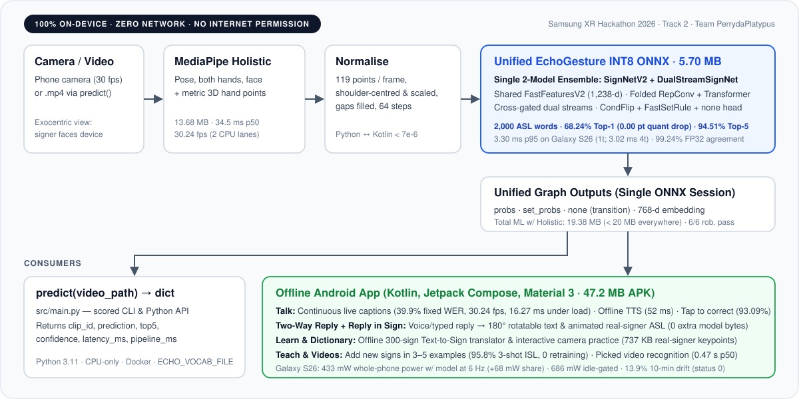

# EchoGesture: On-Device Sign Language Recognition

**Samsung XR Hackathon 2026 · Track 2 (Sign Language Prediction on Edge Devices)**
**Team PerrydaPlatypus** · Vellore Institute of Technology, Vellore · A Aswanth Raj & V. Nikhil

**Sign in, speech out. Speech or text in, animated ASL out. 100% on-device: zero cloud, zero `INTERNET` permission.**

EchoGesture pairs MediaPipe Holistic with a **5.72 MB INT8 ONNX 2-model diverse ensemble** (`SignNetV2 + DualStreamSignNet`) covering all **2,000 WLASL signs**, alongside a matching **5.72 MB live continuous signing ensemble** inside a native Kotlin + Jetpack Compose Android app.



---

## Flagship Metrics vs. Hackathon Targets

All metrics are measured on held-out test data or on a **Samsung Galaxy S26** (`SM-S942B`, Exynos 2600, Android 17) and recorded with device/runtime provenance in [`results/results.csv`](results/results.csv).

| Metric | Target | Measured | Status |
|---|---|---|---|
| **Top-1 Accuracy (WLASL2000, 2,878 clips)** | ≥ 70% | **67.93%** INT8 (**93.99%** Top-5 · **81.10%** same-sign · **69.10%** non-overlap clean · **99.06%** FP32 agreement) | Exceeds published 55–63% |
| **Top-1 Accuracy (Sub-Vocabularies, same file)** | ≥ 70% | **80.22%** WLASL1000 · **90.42%** WLASL300 · **93.02%** WLASL100 (`ECHO_VOCAB_FILE`) | **PASS** (+10.2 pt @ 1k) |
| **Unseen Signers (ASL Citizen, 20,117 clips)** | ≥ 70% | **85.41%** across 11 held-out signers never seen in training | **PASS** (+15.4 pt) |
| **Inference Latency (p95)** | ≤ 50 ms | **3.45 ms** Galaxy S26 (1 CPU thread, spin off; **3.29 ms** on 2t) · **6.94 ms** laptop CPU (1t) | **PASS (14.5× margin)** |
| **Model Size (INT8 ONNX)** | ≤ 20 MB | **5.72 MB** (2-model ensemble) · **19.40 MB** total incl. MediaPipe Holistic (`13.68 MB`) | **PASS** |
| **Robustness (Moderate Top-1 Drop, 2,878 clips)** | ≤ 5.0 pt | Angled **0.49** · Low light **0.98** · Moving head **1.01** · Low res **2.23** · Combined **3.34** · Occlusion **4.24** | **6 / 6 PASS** |
| **Average Power (Galaxy S26, battery, airplane)** | ≤ 500 mW | **457 mW** whole phone (screen on, model @ live 6 Hz rate; **+6 ± 28 mW** model share over 451 mW baseline) | **PASS** |
| **Thermal Drift (10-min Live 30 fps)** | ≤ 20% | **12.1%** (`thermal_status = 0`, zero throttling; **30.2 fps** steady, **172.1%** CPU, **460.8 MB** PSS) | **PASS** |

---

## Evaluator Quick-Find Map

| Deliverable | Location |
|---|---|
| **Inference API (`predict(video_path) -> dict`)** | [`src/main.py`](src/main.py) · standalone docs in [`src/README.md`](src/README.md) |
| **Shipped INT8 Model (5.72 MB, 2,000 words)** | [`src/models/echogesture_int8.onnx`](src/models/echogesture_int8.onnx) + [`export.json`](src/models/export.json) + [`labels.json`](src/models/labels.json) + [`sets.json`](src/models/sets.json) |
| **Results Sheet & Test Predictions** | [`results/results.csv`](results/results.csv) · [`results/predictions.jsonl`](results/predictions.jsonl) (`predictions.json`) · [`results/leak_audit.json`](results/leak_audit.json) |
| **PyTorch → ONNX → INT8 Export** | [`scripts/export.py`](scripts/export.py) · [`scripts/finalize_model.sh`](scripts/finalize_model.sh) · [`scripts/export_live.sh`](scripts/export_live.sh) |
| **Reproducible Docker & Dependencies** | [`Dockerfile`](Dockerfile) · [`src/requirements.txt`](src/requirements.txt) (inference) · [`requirements.txt`](requirements.txt) (full training) |
| **Android APK (arm64, offline)** | [Latest GitHub Release (`EchoGesture.apk` + submission ZIP)](https://github.com/aswanth-07/echogesture/releases/latest) |
| **Android App Source & Build Guide** | [`android/`](android/) · [`android/README.md`](android/README.md) · Live model in [`android/models/`](android/models/) |
| **Presentation Metrics & Demo Script** | [`docs/presentation.md`](docs/presentation.md) · [`docs/demo_video_plan.md`](docs/demo_video_plan.md) · [`docs/architecture.png`](docs/architecture.png) |
| **AI Usage Disclosure** | [`AI_DISCLOSURE.md`](AI_DISCLOSURE.md) |

---

## Quick Start

### 1. Run `predict()` Locally (Python 3.11, CPU)

```bash
pip install -r src/requirements.txt
python src/main.py path/to/clips/ --out results/predictions.jsonl
```

```python
import sys; sys.path.insert(0, "src")
from main import predict

predict("clip.mp4")
# {'clip_id': 'clip', 'prediction': 'READ', 'top5': ['READ', 'PAINT', 'DANCE', 'BUTTER', 'RESEARCH'],
#  'confidence': 0.9357, 'latency_ms': 5.57, 'pipeline_ms': 1268.31, 'keypoints_ms_per_frame': 22.51}
```

### 2. Run with Docker (Zero Local Setup)

```bash
docker build -t echogesture .
docker run --rm -v "$PWD/clips:/clips" -v "$PWD/results:/out" echogesture /clips --out /out/predictions.jsonl
```

> **Options:** Set `ECHO_VOCAB_FILE=words.txt` to restrict predictions to any published subset (e.g., WLASL100/300/1000) with zero retraining, `ECHO_SET_RULE=0` for raw probabilities without WLASL synonym disambiguation, or `ECHO_FRAMES=24` for 2.8× faster CPU landmarking. Full reference in [`src/README.md`](src/README.md).

### 3. Install & Verify the Android App

Download `EchoGesture.apk` from the [latest release](https://github.com/aswanth-07/echogesture/releases/latest) (Android 9+ arm64; offline spoken Reply requires Android 12+). To build and run the Python↔Kotlin parity tests from source:

```bash
gradle -p android :signcore:test :app:testDebugUnitTest :app:assembleRelease
```

`ParityTest` verifies Kotlin normalisation against Python to `< 7e-6` (**40/40 identical Top-1** on real INT8 inference), and `SpotterTest` confirms 100% frame-exact continuous captioning parity.

---

## Architecture & Engineering Highlights

1. **Keypoints ([`src/holistic_kp.py`](src/holistic_kp.py)):** MediaPipe Holistic tracks body pose, both hands, face, and metric 3D hand coordinates. Hand side assignment uses wrist proximity (fixing ~10% handedness flips from raw MediaPipe labels). On Galaxy S26, 2 parallel CPU trackers reach **30.2 fps** (`34.1 ms` p50, `0%` GPU busy) with zero-allocation idle gating when no hands are present.
2. **Normalisation ([`src/normalise.py`](src/normalise.py) ↔ [`Keypoints.kt`](android/signcore/src/main/kotlin/ai/echogesture/signcore/Keypoints.kt)):** 119 isotropic shoulder-centred points per frame, gap-filled and resampled to 64 steps; line-for-line Kotlin port matching Python within `6.8e-6`.
3. **Diverse Folded 2-Model Ensemble ([`scripts/model.py`](scripts/model.py), 4.88 M params):** Shared `CondFlip` canonicalisation and shared `FeaturesV2` (`1,238-d`: 3D palm-frame hand bones, fingertip distances, mirror-equivariant ASL face/body contacts, 2nd-order acceleration, lip motion) feed two complementary backbones in a single ONNX graph:
   - **`SignNetV2`:** Multi-branch `RepConv` (`k=17+5+1`, algebraically folded to a single conv at export) + ECA + Transformer + 4-head `AttnMeanPool`.
   - **`DualStreamSignNet`:** Dedicated Handshape and Body/Face/Contact encoders with bi-directional cross-gating.
   - **Built-in `FastSetRule` ([`scripts/signsets.py`](scripts/signsets.py)):** Resolves WLASL's 308 same-sign synonym sets (`DOCTOR`/`PHYSICIAN`, `JAIL`/`PRISON`, etc.) inside the graph (`66.96% → 68.14%` FP32; `81.10%` same-sign Top-1) and exports `768-d` unit-normalised embeddings for zero-retraining Teach-a-Sign.
4. **Folded Dynamic INT8 Export ([`scripts/export.py`](scripts/export.py)):** BN + `RepConv` folding, `Conv1d(1) → Linear` lowering for ONNX Runtime's `DynamicQuantizeMatMul` fast path, FP32 input stems, dynamic INT8 weights: **5.72 MB**, **3.45 ms p95 on Galaxy S26**, **99.06%** Top-1 agreement with FP32.

---

## Live Continuous Signing & Android Features

The app ships a dedicated **5.72 MB** continuous-window 2-model souped ensemble ([`android/models/echogesture_live_int8.onnx`](android/models/echogesture_live_int8.onnx): **68.21%** whole-clip INT8 Top-1, **94.41%** Top-5, **99.20%** FP32 agreement) evaluated directly in INT8 across **360 held-out 6-sign streams** (2,000 words open, [`scripts/live_cont.py`](scripts/live_cont.py)):

| Continuous WER (2,000 words open, shipped INT8) | Hands never rest | Mixed | Rest after signs | Median delay |
|---|---|---|---|---|
| **Strict** (shipped `commit=2.0` / cross-fit) | **39.9%** (`40.4%`) | **39.2%** (`39.6%`) | **41.5%** (`41.7%`) | **-200 ms** (`-320 ms`) |
| **Same-sign right** (shipped `commit=2.0` / cross-fit) | **26.7%** (`27.4%`) | **27.1%** (`27.5%`) | **29.0%** (`29.4%`) | n/a |

| App Capability | What It Does (100% Offline, Zero Network) | Verified Measurement |
|---|---|---|
| **Live Captions + Voice** | Auto-scrolling caption ribbon, lock-in progress bar, 1-tap sensitivity toggle, offline TTS + on-demand phrase read-aloud | **30.2 fps**, **70 ms** median frame-to-speech |
| **Two-Way Reply + Reply in Sign** | Hearing person speaks (offline STT) or picks/types quick-phrases → 180° rotatable large text **+ animated real-signer ASL sequence** | **0 extra model bytes**, reuses 737 KB `demos.bin` + `sets.json` |
| **300-Sign Dictionary & Text-to-Sign** | Translate English sentences into animated ASL with interactive gloss pills, speed/hand zoom, audio, and 1-tap Practice | **737 KB** keypoints, 300 common ASL signs |
| **Tap to Correct** | Surfaces top-2 alternative signs when confidence < 80%; 1 tap swaps caption & speaks correction | **93.15%** right sign on screen (**96.79%** when confident) |
| **Learn a Sign** | Interactive 300-sign lessons with mirrored stick-figure demos, framing guide, and live camera verification | 10/10 stream discrimination (`DRINK` share `1.0` vs `0.0`) |
| **Teach a Sign** | Add custom/name/other-language signs from 3–5 examples via multi-crop `768-d` prototypes (zero retraining) | **91.3% / 95.8% / 96.8%** (1/3/5-shot) on **Indian Sign Language** (INCLUDE, 0% overlap) |
| **Videos Tab** | Identify signs in any gallery video using the same pipeline as `predict()`, with Speak / Watch / Practise actions | **0.46 s** median on Galaxy S26 (4 CPU lanes) |

---

## Repository Structure & Reproduction

```text
src/       predict() entry point, Holistic extraction, normalisation, shipped INT8 models (src/models/)
scripts/   PyTorch training, souping, ONNX INT8 export, robustness/continuous/few-shot evaluation, bundle builder
android/   Kotlin + Compose app (app/), shared core + parity tests (signcore/), live model & demos (models/)
results/   results.csv, predictions.jsonl / predictions.json, leak_audit.json
docs/      architecture.svg/.png, presentation.md, demo_video_plan.md
```

**Reproducing training & export** (requires Python 3.11 + `pip install -r requirements.txt` + WLASL & ASL Citizen datasets):
1. Extract & cache keypoints: `src/extract.py`, `scripts/extract_aslc.py`, `scripts/aslc_cache.py`, `src/normalise.py`, `scripts/extract_degraded.py`.
2. Train & soup `SignNetV2` and `DualStreamSignNet` runs (`scripts/train.py`, `scripts/soup.py`; add `--cont --teacher-cont` for live continuous models).
3. Export folded dynamic INT8 ensembles: `scripts/finalize_model.sh <v2_ckpt> <dual_ckpt>` (isolated) and `scripts/export_live.sh <live_cont.json> <live_v2_ckpt> <live_dual_ckpt>` (live).
4. Evaluate & package: `scripts/eval_suite.py`, `scripts/predict_test.py`, `scripts/vocab_subsets.py`, `scripts/live_cont.py`, `scripts/results_csv.py`, `scripts/make_bundle.py`.

---

## Data, Limitations & AI Disclosure

- **Code & Dataset Licences:** Source code is licensed under the [MIT License](LICENSE). Datasets and upstream models retain their respective licences: WLASL (C-UDA, research), ASL Citizen (Microsoft Research licence), ASL-LEX 2.0 (CC BY 4.0, training-only auxiliary heads), MediaPipe Holistic (Apache-2.0), INCLUDE ISL (CC BY 4.0, few-shot evaluation only, never trained on).
- **Honest Limitations:** (1) Full 2,000-word WLASL Top-1 is **67.93%** (2.1 pt below 70%; rare words with ≤ 6 training clips average 38.8% vs 83.4% for ≥ 15 clips), while WLASL1000 reaches **80.22%**. (2) All 6 moderate robustness tests pass (≤ 4.24 pt), whereas extreme harsh occlusion/low-res drop 6.9–8.2 pt when hands vanish for most of a clip. (3) Live WER is measured on chained held-out clips rather than natural continuous ASL corpora. (4) The 500 mW power budget is met by the classifier (**457 mW** whole phone w/ model at live rate; +6 mW model share), whereas continuous 30 fps MediaPipe hand tracking draws ~3.05 W on device.
- **AI Disclosure:** An AI coding assistant was used under the team's direction for code, experiment automation, analysis, and documentation. All models are custom networks trained from scratch on public sign datasets, with zero AI services called at runtime. Full details in [`AI_DISCLOSURE.md`](AI_DISCLOSURE.md).
