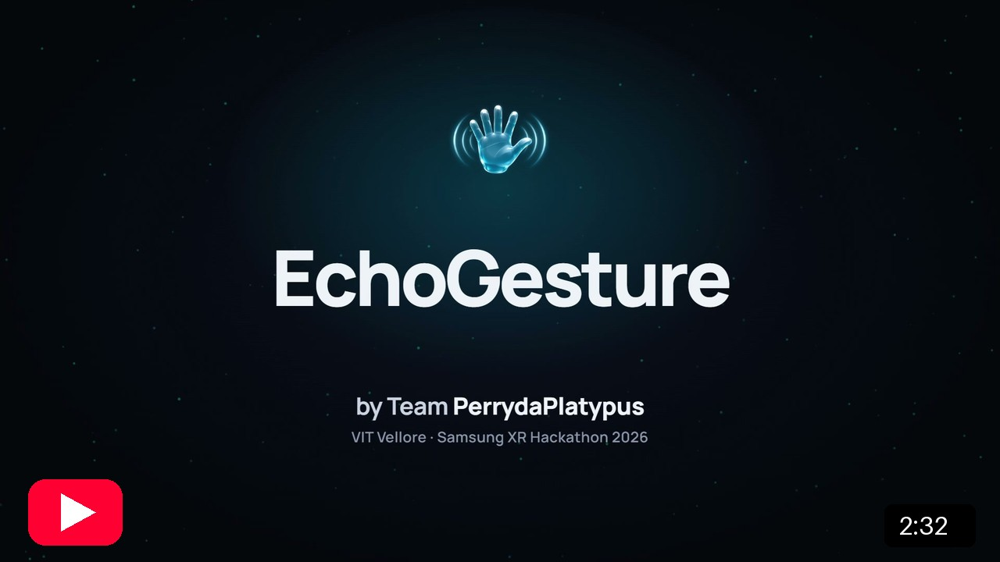
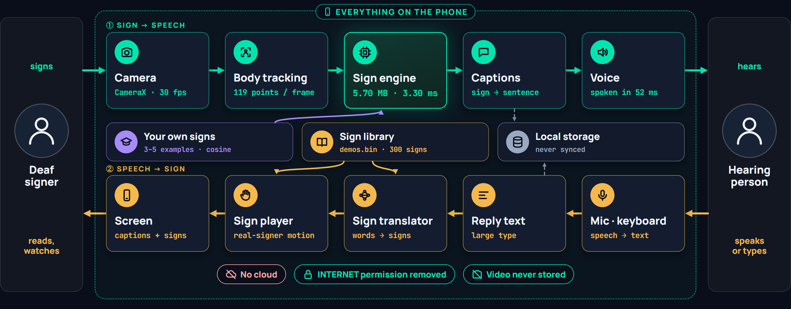
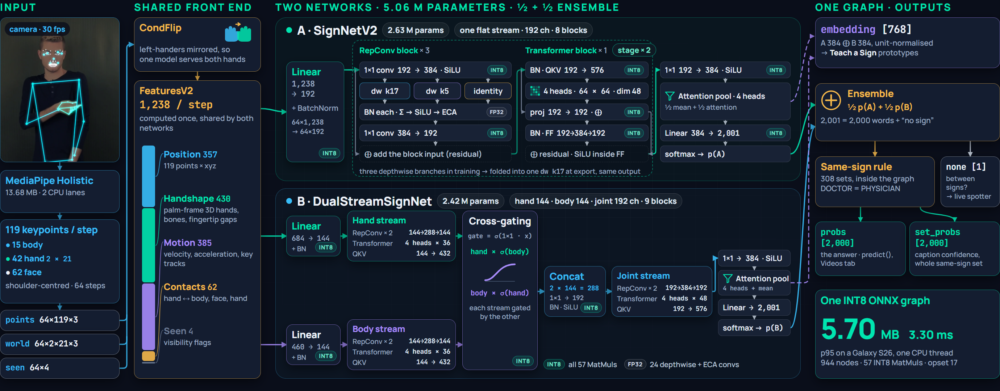
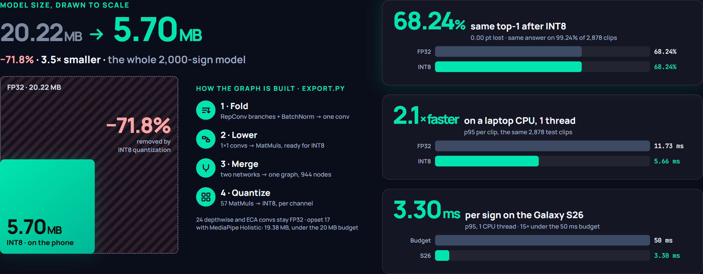

# EchoGesture: On-Device Sign Language Recognition

**Samsung XR Hackathon 2026 · Track 2 (Sign Language Prediction on Edge Devices)**
**Team PerrydaPlatypus** · Vellore Institute of Technology, Vellore · A Aswanth Raj & V. Nikhil

**Sign in, speech out. Speech or text in, animated ASL out. 100% on-device: zero cloud, zero `INTERNET` permission.**

One **5.70 MB INT8 ONNX model** (a two-network ensemble, `SignNetV2` + `DualStreamSignNet`) recognises all
**2,000 WLASL signs**: **68.24% top-1** on the 2,878 held-out test clips and **3.30 ms p95 per sign on a Galaxy S26**.
With MediaPipe Holistic (`13.68 MB`) the whole ML footprint is **19.38 MB**. The same model drives live captions,
Teach-a-Sign and a native Kotlin + Jetpack Compose Android app.

[](https://youtu.be/MOmjmc9EhGg)

▶ **Demo video (2:32): <https://youtu.be/MOmjmc9EhGg>**

---

## Submission checklist

| Item | Where it is |
|---|---|
| **Submission package** (as per the theme) | [`VIT_Vellore_PerrydaPlatypus.zip`](https://github.com/aswanth-07/PerrydaPlatypus/releases/latest/download/VIT_Vellore_PerrydaPlatypus.zip) in the [latest release](https://github.com/aswanth-07/PerrydaPlatypus/releases/latest): `src/` (the scored `predict()` with the model) and `results/` (`results.csv`, test predictions, leak audit) |
| **Source code** | [`src/`](src/) the scored `predict()` and the shipped model · [`scripts/`](scripts/) training, ONNX INT8 export, evaluation · [`android/`](android/) the Android app |
| **Presentation** | [`presentation/VIT_Vellore_PerrydaPlatypus.pdf`](presentation/VIT_Vellore_PerrydaPlatypus.pdf) (13 slides) · [`.pptx`](presentation/VIT_Vellore_PerrydaPlatypus.pptx) |
| **Video** | [YouTube, 2:32](https://youtu.be/MOmjmc9EhGg) · the same file is in the [latest release](https://github.com/aswanth-07/PerrydaPlatypus/releases/latest) as `VIT_Vellore_PerrydaPlatypus_Demo.mp4` |
| **AI disclosure** | [`AI_DISCLOSURE.md`](AI_DISCLOSURE.md) |
| **README** | this file · [`src/README.md`](src/README.md) (`predict()` reference and options) · [`android/README.md`](android/README.md) (every screen, building the app) |
| **APK** | [`EchoGesture.apk`](https://github.com/aswanth-07/PerrydaPlatypus/releases/latest/download/EchoGesture.apk) (47.2 MB, arm64, Android 9+; spoken replies need Android 12+) |
| **Results** | [`results/results.csv`](results/results.csv) (every metric with its device and runtime) · [`results/predictions.jsonl`](results/predictions.jsonl) · [`results/leak_audit.json`](results/leak_audit.json) |

---

## Test the model on your own machine

Everything `predict()` needs is in this repository ([`src/models/`](src/models/)); nothing is downloaded at run
time and nothing leaves the machine. Python **3.11**, CPU only.

### 1. Python

```bash
git clone https://github.com/aswanth-07/PerrydaPlatypus.git
cd PerrydaPlatypus

python3.11 -m venv .venv               # Windows: py -3.11 -m venv .venv
source .venv/bin/activate              # Windows: .venv\Scripts\activate
pip install -r src/requirements.txt

python src/main.py path/to/clips/ --out results/my_predictions.jsonl
```

`path/to/clips/` is one `.mp4` or a folder of them. Each clip becomes one line of JSON, as the brief specifies:

```json
{"clip_id": "68400", "prediction": "READ", "top5": ["READ", "BUTTER", "RESEARCH", "PAINT", "FORK"],
 "confidence": 0.9662, "latency_ms": 8.61, "pipeline_ms": 812.4, "keypoints_ms_per_frame": 32.1}
```

Or from Python:

```python
import sys; sys.path.insert(0, "src")
from main import predict

predict("clip.mp4")   # -> the dict above
```

`latency_ms` is the model's inference time per clip (the figure the 50 ms budget is about); `pipeline_ms` is the
whole clip on one CPU thread, including video decoding and MediaPipe Holistic.
Options: `ECHO_VOCAB_FILE=words.txt` restricts answers to any word list (for example WLASL100/300/1000) with no
retraining, `ECHO_SET_RULE=0` returns raw probabilities without the same-sign rule, and `ECHO_FRAMES=24` landmarks
fewer frames for 2.8× faster CPU runs. Full reference: [`src/README.md`](src/README.md).

### 2. Docker (no local Python needed)

```bash
docker build -t echogesture .
docker run --rm -v "$PWD/clips:/clips" -v "$PWD/results:/out" echogesture /clips --out /out/predictions.jsonl
```

### 3. The Android app

1. Download [`EchoGesture.apk`](https://github.com/aswanth-07/PerrydaPlatypus/releases/latest/download/EchoGesture.apk) on an arm64 phone (Android 9+) and install it.
2. Open it, allow the camera, and sign in front of it on the **Talk** tab: captions appear and are spoken. Airplane mode changes nothing.
3. **Learn** has 300 signs with a dictionary and text-to-sign; **Videos** names the sign in a saved video; **Teach the app a sign** adds your own.

To build it and run the Python↔Kotlin parity tests from source:

```bash
gradle -p android :signcore:test :app:testDebugUnitTest :app:assembleRelease
```

`ParityTest` checks the Kotlin normalisation against Python to `< 7e-6` (**40/40 identical top-1** on real INT8
inference); `SpotterTest` checks continuous captioning frame for frame. Details: [`android/README.md`](android/README.md).

---

## Results against the hackathon targets

All metrics are measured on held-out test data or on a **Samsung Galaxy S26** (`SM-S942B`, Exynos 2600, Android 17)
with the final **`5.70 MB`** model, and recorded with device and runtime in [`results/results.csv`](results/results.csv).

| Metric | Target | Measured | Status |
|---|---|---|---|
| **Top-1 accuracy (WLASL2000, 2,878 clips)** | ≥ 70% | **68.24%** INT8 (**0.00 pt** drop from FP32 · **94.51%** top-5 · **81.48%** same-sign · **99.24%** FP32 agreement) | Ahead of published 55–63% |
| **Top-1 accuracy (smaller vocabularies, same model)** | ≥ 70% | **79.96%** WLASL1000 (`97.01%` top-5) · **90.72%** WLASL300 · **93.41%** WLASL100 (`ECHO_VOCAB_FILE`) | **PASS** |
| **Unseen signers (ASL Citizen, 20,117 clips)** | ≥ 70% | **85.41%** on 11 held-out signers never seen in training | **PASS** |
| **Inference latency (p95)** | ≤ 50 ms | **3.30 ms** on the Galaxy S26 (1 CPU thread; **3.02 ms** with 4) · **5.66 ms** laptop CPU (1 thread) | **PASS (15× margin)** |
| **Model size (INT8 ONNX)** | ≤ 20 MB | **5.70 MB** · **19.38 MB** with MediaPipe Holistic (`13.68 MB`) | **PASS** |
| **Robustness (top-1 drop, 2,878 clips)** | ≤ 5.0 pt | Angled **0.59** · Low light **0.87** · Moving head **0.90** · Low res **2.36** · Occlusion **3.75** · Combined **3.99** | **6 / 6 PASS** |
| **Average power (Galaxy S26, battery, airplane mode)** | ≤ 500 mW | **433 mW** whole phone, screen on, model at the live 6 Hz rate | **PASS** |
| **Thermal drift (10 min live, 30 fps)** | ≤ 20% | **13.9%** (`1.6%` fps drop, no throttling, **30.24 fps** steady) | **PASS** |

---

## How it works

### System design



The signer's frames go to MediaPipe Holistic, the 119 keypoints per frame go to the sign engine (one ONNX graph),
captions are built and spoken in the phone's offline voice. The hearing person replies by voice (on-device speech
recognition) or by typing; the reply is shown in large type and played back in sign from 300 real signers'
keypoint recordings (`demos.bin`, 737 KB). Taught signs, conversations and progress stay in the app's private
storage. The manifest removes the `INTERNET` permission.

### The model



1. **Keypoints ([`src/holistic_kp.py`](src/holistic_kp.py)):** MediaPipe Holistic tracks the body, both hands, the face and 3D hand points. Hands are assigned by wrist distance, which fixes the ~10% of frames where MediaPipe's handedness label is wrong.
2. **Normalisation ([`src/normalise.py`](src/normalise.py) ↔ [`Keypoints.kt`](android/signcore/src/main/kotlin/ai/echogesture/signcore/Keypoints.kt)):** 119 shoulder-centred points per frame, gap-filled and resampled to 64 steps; the Kotlin port matches Python within `6.8e-6`.
3. **Two networks, one graph ([`scripts/model.py`](scripts/model.py), 5.06 M parameters):** a shared `CondFlip` (left-handers mirrored) and `FeaturesV2` (1,238 features per step) feed
   - **`SignNetV2`:** RepConv blocks (depthwise k17 + k5 + identity, folded into one conv at export), ECA and Transformer blocks, attention pooling;
   - **`DualStreamSignNet`:** separate hand and body streams that gate each other, then a joint stream.
   Their probabilities are averaged, and a same-sign rule inside the graph resolves WLASL's 308 synonym sets (`DOCTOR` = `PHYSICIAN`; [`scripts/signsets.py`](scripts/signsets.py)). The same graph also outputs a 768-d embedding for Teach-a-Sign and a "between signs" score for live captions.

### 3.5× smaller, 2.1× faster, zero accuracy lost



[`scripts/export.py`](scripts/export.py) folds every RepConv block and BatchNorm into single layers, turns pointwise
convolutions into MatMuls, exports one opset-17 graph (944 nodes) and quantizes its 57 MatMuls to INT8 per channel
(dynamic activations); the 24 depthwise and ECA convolutions stay FP32. Result: **20.22 MB → 5.70 MB** with the
same **68.24%** top-1.

---

## Live signing and the app

Live captions are evaluated in INT8 on **360 held-out 6-sign streams** with all 2,000 words open
([`scripts/live_cont.py`](scripts/live_cont.py)):

| Continuous WER (2,000 words) | Hands never rest | Mixed | Rest after signs | Median delay |
|---|---|---|---|---|
| **Strict** (shipped setting / cross-fit) | **39.9%** (`40.3%`) | **39.0%** (`39.4%`) | **41.5%** (`41.5%`) | **-200 ms** (`-320 ms`) |
| **Same sign counted right** | **26.7%** (`27.2%`) | **26.9%** (`27.4%`) | **28.9%** (`29.2%`) | n/a |

| Feature | What it does (offline) | Measured |
|---|---|---|
| **Live captions + voice** | Captions as the hands move, spoken in the phone's offline voice | **30.24 fps**, **52 ms** median to voice |
| **Reply, in text and in sign** | The hearing person speaks (offline speech recognition) or types; the reply shows large and plays as animated ASL | no extra model bytes: `demos.bin` (737 KB) |
| **Dictionary & text-to-sign** | English sentences to animated ASL from 300 signs, with practice | 300 signs, 737 KB |
| **Tap to correct** | Offers the next two signs when unsure; one tap fixes and speaks the caption | **93.09%** right sign on screen |
| **Learn a sign** | 300-sign lessons; the camera checks your try | 300 signs in 21 topics |
| **Teach a sign** | Add a name or a sign from another language from 3 to 5 examples, no retraining | **91.5% / 95.8% / 96.8%** (1 / 3 / 5 examples) on unseen **Indian Sign Language** |
| **Videos** | Names the sign in a saved video with the same pipeline as `predict()` | **0.47 s** p50 on the Galaxy S26 |

---

## Repository map

```text
src/            predict() and the shipped model (models/: echogesture_int8.onnx, labels, same-sign sets, Holistic)
scripts/        training, souping, ONNX INT8 export, robustness / continuous / few-shot evaluation, packaging
android/        the Kotlin + Jetpack Compose app (app/), shared core and parity tests (signcore/), live config and sign library (models/)
results/        results.csv, test predictions, leak audit
presentation/   the deck, PDF and PPTX
docs/           the diagrams above and the video thumbnail
Dockerfile      predict() in a container
AI_DISCLOSURE.md, LICENSE (MIT)
```

### Reproduce training and export

Needs Python 3.11, `pip install -r requirements.txt` and the WLASL and ASL Citizen datasets.

1. Extract and cache keypoints: `src/extract.py`, `scripts/extract_aslc.py`, `scripts/aslc_cache.py`, `scripts/extract_degraded.py`.
2. Train and soup `SignNetV2` and `DualStreamSignNet`: `scripts/train.py`, `scripts/soup.py`.
3. Export the folded INT8 model and the live config: `scripts/finalize_model.sh <v2_ckpt> <dual_ckpt>`, `scripts/export_live.sh <live_cont.json>`.
4. Evaluate and package: `scripts/eval_suite.py`, `scripts/predict_test.py`, `scripts/vocab_subsets.py`, `scripts/live_cont.py`, `scripts/results_csv.py`, `scripts/make_bundle.py`.

---

## Data, licences and limits

- **Licences:** the code is [MIT](LICENSE). Datasets and upstream models keep their own licences: WLASL (C-UDA, research), ASL Citizen (Microsoft Research licence), ASL-LEX 2.0 (CC BY 4.0, training-only auxiliary labels), MediaPipe Holistic (Apache-2.0), INCLUDE ISL (CC BY 4.0, used only to measure Teach-a-Sign, never trained on).
- **Limits:** full 2,000-word top-1 is 68.24%; words with 6 or fewer training clips average about 39% against about 83% for words with 15 or more. Extreme occlusion or very low resolution, where the hands are hidden for most of a clip, costs 7.0–9.6 pt. Live WER is measured on chained held-out clips rather than a natural continuous-signing corpus. Continuous 30 fps hand tracking draws more than the classifier (2.94 W active, 686 mW idle-gated).
- **AI disclosure:** an AI coding assistant was used under the team's direction for code, experiments, analysis, documents, the slide visuals and the video edit. The model is our own network trained from scratch on public sign datasets, and no AI service runs at run time. Details, including the AI-generated media in the deck and video: [`AI_DISCLOSURE.md`](AI_DISCLOSURE.md).
